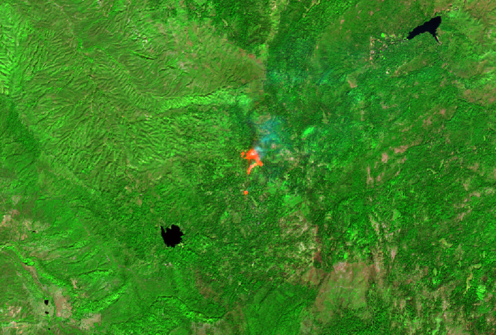

# Crew Air

**Smoke and heat forecasts turned into a shift plan, so the job site keeps working and stays within the law.**

Stanford Cleantech Hackathon 2026 · Track 2 Climate & Health · Track 1 Energy & the Grid (the same hours for a home, airsignal.app/crew/grid) · Track 3 Resilient Systems (building, home and sensor signals; line crews after a fire)
· **Live: [airsignal.app/crew](https://airsignal.app/crew)** · [Pitch deck](https://claude.ai/artifact/Kxr2SHzzCTs2JyCXoSFSsQ) · [pitch/](pitch/)

## The problem

California already writes down what an outdoor employer must do: at PM2.5 AQI 151 provide N95s and tell the
crew (Cal/OSHA §5141.1), at 80°F shade and water, at 95°F high-heat procedures (§3395). Almost nobody does it.

- In the 2020–21 fire seasons California farmworkers spent at least **4.5 million worker-days** at AQI 151+
  (our calculation from EPA AirData × BLS QCEW, [docs/evidence.md](docs/evidence.md)). Cal/OSHA issued
  **11** smoke-rule citations from July 2019 to October 2021.
- About 60% of 300+ Central Valley farmworkers got no N95 from their employer (CCEJN survey).
- Heat is the opposite: the most-cited Cal/OSHA standard in agriculture every year, and the classic miss is
  no written plan in the field.

Inspection waits for complaints, and workers are afraid to complain.

## What it does

1. **Shift plan.** Place, day and shift in; the hour each rule starts, the action it requires, the clear window
   for heavy work, and when a building should close outside air (BMS). One printed sheet with a pre-shift
   briefing sign-off.
2. **Checked four ways.** Model (hourly forecast, AQI as an EPA NowCast, not the 24-hour mean forecast feeds
   give), satellite (NASA VIIRS fires within 50 km → warning), ground (AirNow monitors within 25 km; a
   1.5x disagreement scales the forecast toward the monitor, never below half), and the crew.
3. **Check the sky.** A photo of the horizon (phone or the page) goes to TypeSafe's Jev, a vision decision
   model that answers typed questions with probabilities. The phone blurs faces and crops to the sky first.
   On 12 public-domain photos with known answers it made the smoke call right 11–12/12 across runs, never
   wrongly (`work/sky_eval.py`, `work/sky_eval.md`); its visibility estimate was unreliable, so the verdict
   rests on the smoke question and visibility shows only when confident. Visible smoke under a forecast
   below AQI 101 is flagged as "looks worse than the forecast" and pre-fills a report.
4. **Worker reports, the ladder.** A worker reports smoke, ash, symptoms, or missing N95s, shade or water. No
   name, and the evidence for that hour attached. The crew lead marks it handled. After 30 minutes an open report can go further,
   anonymously (Cal/OSHA complaint link is real; union and legal-aid forwarding is a mock until they agree).

```bash
curl 'https://airsignal.app/api/crew?place=Fresno&shift=07-17'          # plan + checks + BMS, home, alerts, wind, fires_near, dispatch (JSON)
# every endpoint: https://airsignal.app/api · a utility's 13 cities: https://airsignal.app/crew/grid
curl 'https://airsignal.app/api/crew/reports?place=Fresno'               # today's reports
curl -H 'content-type: image/jpeg' --data-binary @sky.jpg \
     'https://airsignal.app/api/sky-check?place=Fresno'                  # Jev on a sky photo
make plan P="Fresno" S=07-17                                             # the same engine idea in Python
make test                                                                # Python rules + NowCast tests
make evidence                                                            # the 4.5M worker-days table
```

## Where the code is

| Piece | Where | Built during the hackathon |
|---|---|---|
| Engine: NowCast, rulebook, plan, BMS, fire and monitor checks | [airq `airq-core/src/crew.rs`](https://github.com/fortunto2/airq/blob/main/airq-core/src/crew.rs) (Rust → WASM) | yes, all of it |
| Page, API, reports, escalation mock, sky check | [air-signal-web `src/pages/crew.astro`, `src/lib/crew.ts`, `src/pages/api/crew/`, `src/pages/api/sky-check.ts`](https://github.com/fortunto2/air-signal-web) | yes, all of it |
| Python CLI + rulebook YAML + tests, evidence script | this repo: `crewair/`, `rulebooks/`, `tests/`, `work/` | yes |
| iOS app: Plan, Sky (AR horizon + Jev check), Report, crew lead | this repo: `ios/` (`make -C ios gen test build install`) | yes |
| Evidence and the Jev eval | this repo: `work/evidence_*.py`, `work/sky_eval.py` | yes |
| Pitch | `pitch/` | yes |

Every commit for the above is dated 23–24 Oct 2026 inside hacking hours (Fri 17:00 – Sat 17:00 PT).

**Earlier open-source work it stands on, disclosed:** the Air Signal site's hosting and layout
(airsignal.app, [air-signal-web](https://github.com/fortunto2/air-signal-web)), and from the
[airq-core](https://github.com/fortunto2/airq) library the EPA AQI breakpoints, the sensor/model merge
(`merge.rs`) and haversine. The iOS AR overlay adapts camera-geometry code from our app
[Starlapse](https://github.com/fortunto2/starlapse). All three are public repositories by the same author,
older than the event. The rest is new.

## Rulebooks: one file per jurisdiction

The engine knows no law. A rulebook names a metric (`us_aqi_pm25`, `pm25_nowcast_ugm3`, `pm25_ugm3`,
`temp_f`, `temp_c`), a threshold, the action and the citation. Smoke rules use the NowCast concentration as
§5141.1 Appendix A does (55.5 and 500.5 µg/m³): an AQI threshold of 501 can never trip, the scale stops at
500. A new state or country is a new file, not new code: Oregon and Washington have smoke rules, Canadian
provinces use AQHI, Spain and Italy restrict outdoor work in heatwaves. Only California ships.

## Data sources

| Source | Key | Use |
|---|---|---|
| Open-Meteo (CAMS air quality + weather) | none | hourly PM2.5 and temperature; free only non-commercially |
| NASA FIRMS VIIRS, public 24 h CSV (NOAA-20, Suomi-NPP) | none | fires within 50 km |
| AirNow hourly files (files.airnowtech.org) | none | regulatory monitors within 25 km |
| EPA AirData, BLS QCEW | none | the evidence table |
| DOL OSHA enforcement API | free key | §5141.1 / §3395 / §3396 citations (`work/evidence_citations.py`) |
| TypeSafe Jev | key (Worker secret) | sky photo → smoke / visibility probabilities |
| Earth Engine, Sentinel-2 | gcloud login | burn scar and fire front for the pitch (`work/`) |
| NOAA HRRR-Smoke | none | next: 3 km smoke over the US instead of CAMS ~40 km |

## Model

Free for crews, paid by employers, public data. The engine, rulebooks and worker app are open source
(AGPL for airq-core and the site, MIT here). Employers pay per site for alerts in Spanish and English, many
sites, the archive an inspector or insurer asks for, and the BMS feed. Raw reports stay private; exposure
and report counts by county are published anonymized.

## Satellite side (Earth Engine)

`work/` holds the GEE 101 workshop run locally plus two scripts on the largest fire in California on 20 Oct
2026 (NASA FIRMS, near Sequoia): `fire_s2.py` pulls a Sentinel-2 scene, `burn_scar.py` computes dNBR.
Auth: `ee_init.py` uses your gcloud login (`EE_ACCOUNT`, `EE_PROJECT`).



Plan and status: [docs/next.md](docs/next.md). Event notes: [docs/event.md](docs/event.md), tracks and
decision: [docs/tracks.md](docs/tracks.md).

A planning aid, not legal advice.

## License

MIT
